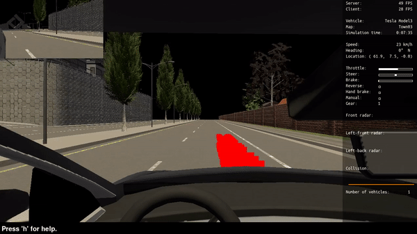
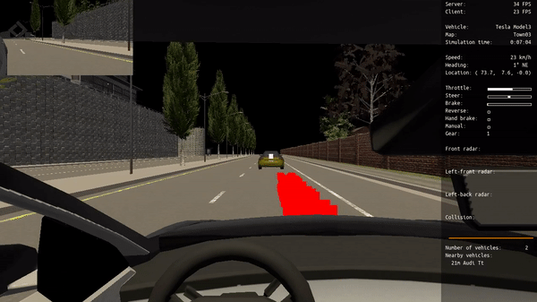
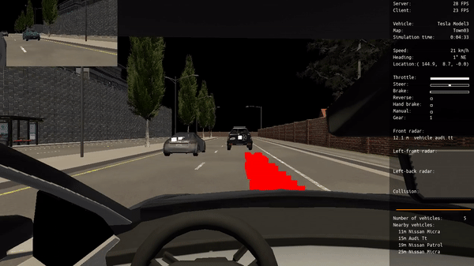
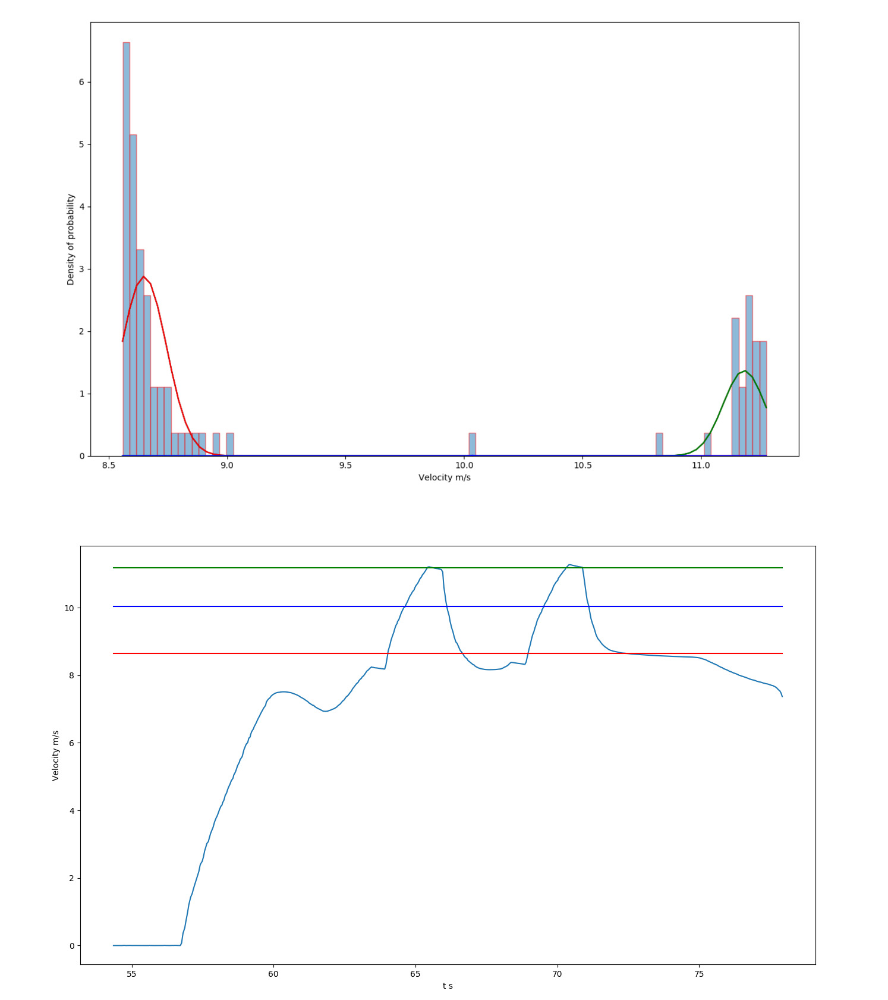
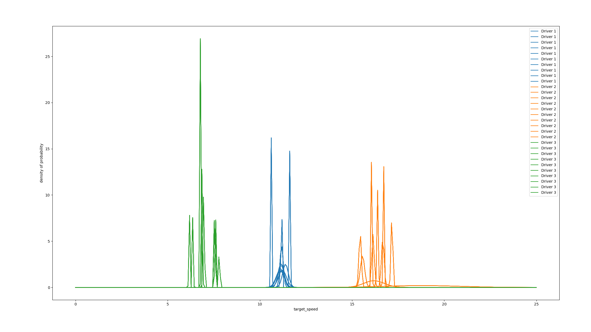
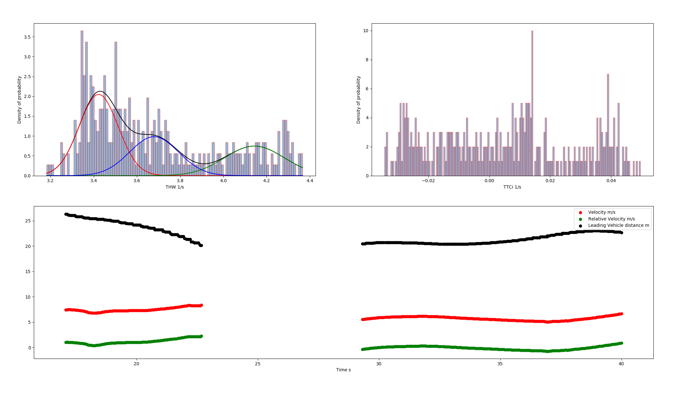
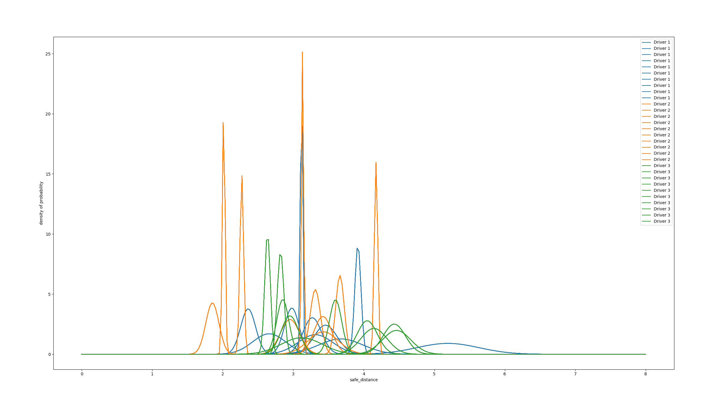
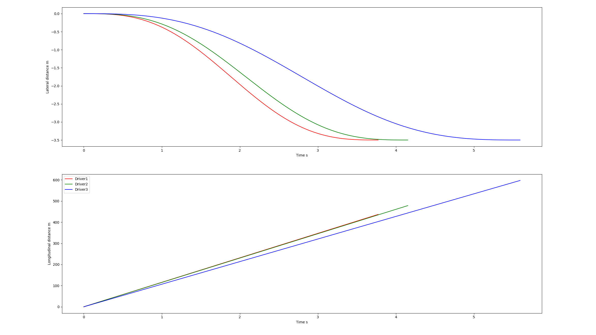

# Personalizing-ADAS-in-CARLA

This project aims to personalize Advanced Driving-assistance Systems ([ADAS](https://en.wikipedia.org/wiki/Advanced_driver-assistance_systems)) for autonomous vehicles with the self-driving cars simulator [CARLA](http://carla.org/). The two main focus are on personalizing ***lane changing*** and personalizing Adaptive Cruise Control ([ACC](https://en.wikipedia.org/wiki/Adaptive_cruise_control)) that includes ***vehicle following*** a*nd **lane following***. 

## Demonstration

<p align = "center">
    
    <br>
    <em>Lane Following Case</em>
    <br>
    
    <br>
    <em>Vehicle Following Case</em>
    <br>
    
    <br>
    <em>Lane Changing Case </em> 
    <br>
</p>

## Test Platform

Ubuntu 18.04
[CARLA](http://carla.org/) 0.9.8

#### Carla Simulator Installation
Go to official [Carla Releases](https://github.com/carla-simulator/carla/releases) Github page.

Download **[Linux] CARLA 0.9.8**, unzip the file and rename the folder as **CARLA_Simulator**. Additional maps are optional.

Put **CARLA_Simulator** folder and **this repository** folder in the same folder. So the folder structure should look like:

```
Carla                              
├── Assistive-Driving-in-CARLA     # This repository
│   ├── agents                     # Self-driving and Personalization module
│   │   ├── ...
│   ├── data                       # Useful data
│   │   ├── ...
│   ├── demo                       # Demonstration for README
│   │   ├── ...
│   ├── environment                # Scenes and different scenes set up
│   │   ├── ...
│   ├── LICENSE                    
│   ├── README.md
└── CARLA_Simulator                # Carla Simulator of suggested version    
    ├── ...                    
```

#### Other prerequisites

`numpy`,  `scikit-learn`,  `casadi`,  `opencv` and `pygame` should be correctly installed.

`jstest-gtk` is also needed if one would run Carla with a hardware steering wheel, a Logitech steering wheel for example.

## Run Instruction

#### Performing Phase

1. Go to **CARLA_Simulator** folder,

   `cd Carla/CARLA_Simulator` 

   run CARLA in Low Graphic Quality

   `./CarlaUE4.sh -quality-level=Low`

   or off-screen mode.

   `DISPLAY= ./CarlaUE4.sh -opengl`

2. Go to the **environment folder** of **this repository**. 

   `cd Carla/Assistive-Driving-in-CARLA/environment `

   There are options for generating different scenes. 

   To perform personalized ACC when there is no vehicle in front, also known as ***lane following***, generate scene 0 where only the ego vehicle exists by:

   `python ego_vehicle.py`

   To perform personalized ACC for ***vehicle following***, generate the first scene where one vehicle is in front of the ego vehicle by:

   `python ego_vehicle.py -s 1`

   To perform personalized ***lane changing***, generate the second scene where multiple vehicles are surrounding the ego vehicle:

   `python ego_vehicle.py -s 2` 
   
3. If one would like to run it with hardware setup, he could run it by:

   `python ego_vehicle.py -hw 1`

   which will use both keyboard, steering wheel and pedal control as vehicle inputs.

   

#### Learning Phase

The vehicle is initialized with autopilot mode on. To switch between manual control and autopilot mode, press `p`. 

To start or end the learning process, press `l` in manual control mode. Noted that starting and ending learning process would only collect driver's behavior data. One has to press `t` to let the model learn from the data and be stored locally.

After learning, one could regenerate the scene by pressing `Backspace` and turn autopilot mode on to see the performance of the vehicle.

It is advisable to personalize ***lane following*** in front in scene 0, to clone ***vehicle following*** behavior in scene 1, and to teach the model ***lane changing*** in scene 2.

## Personalization

Some sets of data of 3 different drivers are stored in **data/Driver_Data**.

#### Lane Following

personalized parameter: **target_speed**

method: **GMM**

<p align = "center">
    
    <br>
    <em>Driver 1 Set 1 Target Speed Histogram Plot & V-t Plot</em>
    <br>
    
    <br>
    <em>All sets of 3 drivers' data</em>
</p>

#### Vehicle Following

personalized parameter: **Time Headway (THW)**

method: **GMM**

<p align = "center">
    
    <br>
    <em>Driver 1 Set 1 THW, TTCi</em>
    
    <br>
    <em>All sets of 3 drivers' data</em>
</p>

#### Lane Changing

personalized parameter: **Lateral Time, Longitudinal Velocity**

method: **GMM + COS Trajectory**

<p align = "center">
    
    <br>
    <em>3 drivers' trained models perform in standard case [10m/s, -3.5m, 15m, -12m]</em>
</p>


## Camera Perception: SNN vs CNN

The optional `perception/` package adds binary camera classification for an obstacle or
vehicle in the ego lane within 25 m. It uses CARLA actor state only to create labels; model
inputs are 128x128 grayscale RGB-camera frames. The SNN and CNN use matching convolution and
classifier dimensions. The existing GMM personalization and navigation agents remain in
place.

### Python environments

CARLA 0.9.8 uses a version-specific Python client egg. Use the Python version encoded in
the egg shipped with your CARLA archive (the Linux 0.9.8 archive is commonly encountered
with a Python 3.5 egg). The CARLA-side collector and driving client must use that matching
interpreter. PyTorch/snnTorch should run in a separate modern Python environment because
the current model packages do not target Python 3.5. The inference bridge uses a local TCP
socket: it sends a 128x128 grayscale frame and receives the obstacle probability and model
inference latency. Confirm the actual egg filename in your CARLA distribution before
selecting the client interpreter.

Install the model, training, and evaluation packages in the modern Python environment:

```bash
python3 -m venv .venv-perception
source .venv-perception/bin/activate
python -m pip install -r requirements-perception.txt
```

The CARLA client environment also needs NumPy and Pillow for data collection/frame resizing,
in addition to this project's existing CARLA, pygame, and NumPy dependencies. Install a
Pillow version compatible with the Python ABI used by the CARLA egg; do not install the
modern PyTorch stack into the legacy CARLA environment.

### Collect labeled data

Start CARLA 0.9.8, then run the collector with the compatible CARLA Python interpreter. It
cycles through scenes 0, 1, and 2, varies spawn point, weather, and traffic density, and
keeps the saved class counts balanced. By default it collects 500 clear and 500 obstacle
frames for each train, validation, and test split.

```bash
python perception/collect_data.py --split all --samples-per-class 500 --seed 1337
```

The collector writes grayscale PNG files and `labels.csv` under
`data/perception/{train,val,test}/`. Scene 0 uses randomized traffic, while scenes 1 and 2
also attempt to place a same-lane lead vehicle. Actor transforms and the ego lane determine
the labels; no manual annotation is used. Collection can stop at `--max-frames-per-split`
if the requested class counts cannot be reached on the active map.

### Train and evaluate

Run both training commands in the modern model environment:

```bash
python -m perception.train --model snn --seed 1337 --num-time-steps 8 --encoding rate
python -m perception.train --model cnn --seed 1337
python -m perception.evaluate --seed 1337
```

Checkpoints are saved to `perception/checkpoints/`; epoch logs are written to
`perception/logs/`. Evaluation compares both checkpoints on the test split and writes
`results/comparison.csv`, `results/accuracy_vs_estimated_energy.png`, and
`results/accuracy_vs_time_steps.png`. It reports accuracy, precision, recall, F1, the
confusion matrix counts, CPU and available GPU mean/p95 latency, parameters, SNN per-layer
spike sparsity and SynOps, and CNN MACs. The energy columns use 4.6 pJ/MAC and 0.9
pJ/accumulate as 45 nm reference proxy constants. These values are estimated, not measured
on hardware; they do not establish hardware energy savings. `--time-steps` can change the
SNN simulation lengths included in the comparison. SNN SynOps use recorded LIF spike counts
times the next layer's fan-out (full convolutional kernel fan-out approximation); output
readout spikes have no downstream fan-out in this count.

### Run with camera-based braking

Start the inference service in the modern Python environment, using the selected checkpoint:

```bash
python -m perception.inference_server --model snn
```

Then launch the CARLA client with the matching CARLA Python interpreter. For the CNN, start
the service with `--model cnn` and launch the client with `--perception cnn`; `none` remains
the default and preserves the existing driving behavior.

```bash
cd environment
python ego_vehicle.py --perception snn --perception-threshold 0.7 -s 1
```

Each new RGB camera frame is sent to the inference service. When obstacle probability meets
the threshold, the existing agent control is changed to zero throttle and full braking
before `apply_control()`. The pygame HUD displays the current probability and inference
latency. Keep the inference service and CARLA client on the same host by default; the service
binds to localhost.

Unit tests for encoders, model output shapes, and the SynOps counter are in
`tests/test_perception.py`; they do not require a running CARLA server.

